# The Sum Surfers Project

**An automated tool for counting surfers and crowd size.**

<p align="center">
  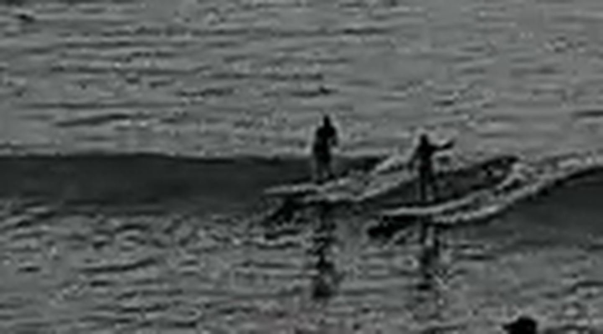
</p>

**Contents:**
[Why count surfers?](#why-count-surfers) ·
[Yesterday's counts and the forecast](#yesterdays-surfer-counts-and-the-near-term-surf-crowd-forecast) ·
[How it works](#how-it-works) ·
[What the data shows](#what-the-data-shows-so-far) ·
[How accurate is this tool?](#how-accurate-is-this-tool) ·
[Limits](#limits-and-missing-data) ·
[What's next](#whats-next) ·
[Try it yourself](#try-it-yourself) ·
[Learn more](#learn-more)

**TLDR:**
- **What it does:** a computer-vision model counts the surfers on a public surf video camera every daylight hour, and a second model forecasts future surf crowd levels.
- **Where:** Jack's, near Pleasure Point in Santa Cruz, California.
- **How long:** Collecting data since fall of 2025 (more than 1,950 hours across 152 days).

## Why count surfers?

***Online surf sites forecast the conditions, but they don't forecast how many people will be there.*** As the crowd grows, so does the competition for each wave, and it gets harder to avoid dropping in on someone or being dropped in on.

As a local surfer in the area, I always want to pick a time with both good conditions and the smallest crowd, or at least know how crowded it will be. As a data scientist, I also thought it would be an interesting project to hone my skills in computer vision, machine learning predictions, and LLM prompt engineering.  ***In short, it's me training an Ai to tell me how crowded my surf break will be each day.***

Crowd forecasting for surf is rare. I haven't found a published study that forecasts hourly surfer counts at a break from surf and weather conditions; the closest work forecasts general beach attendance from camera counts. A few apps show how crowded a spot usually is, and one open-source project, [crowdfactor](https://github.com/craigmulligan/crowdfactor), counts surfers on a Surfline camera in Los Angeles and predicts from the day, time, weather and surf rating. What this project adds is a measured record: the object detector is checked against hand counts, and every forecast is written down before the day and scored afterwards. Sources are in [works cited](docs/works_cited.md).

## Yesterday's surfer counts and the near-term surf crowd forecast

<!-- ====================================================================
     AUTO-GENERATED BLOCK - DO NOT EDIT BETWEEN THE MARKERS BELOW.
     Everything between the DAILY_CHART_START and DAILY_CHART_END markers is
     deleted and rewritten in full by code/plot_daily_prediction.py
     (update_readme) on every nightly run. Hand edits inside that region
     survive until 20:30 and are then silently lost.

     To change this wording, edit the caption templates in that file:
         DETECTION_CAPTION   the detection-GIF paragraph
         FORECAST_CAPTION    the daily-forecast-chart paragraph
         WEEK_CAPTION        the week-ahead-grid paragraph
     The headings and image links are assembled in update_readme() itself.
     ==================================================================== -->
<!-- DAILY_CHART_START -->
#### A Full Day of Surfer Detections: Saturday, October 24, 2026

Each green box is a surfer, according to the detection model. Each hour is shown twice, first bare and then with the boxes, so you can try spotting the surfers yourself first. It still misses some surfers and occasionally boxes something else: [what isn't a surfer](docs/non_surfer_objects.md).


#### The Surfer Crowd Forecast for: Monday, October 26, 2026

The forecast for each hour of the coming day, made the evening before. The aqua line is the best guess, the shaded band is the likely range, the dashed green line is the tide, and the right-hand column rates each hour from 1 (near-empty) to 5 (packed).


#### The Week Ahead: October 26 - November 01, 2026

The same forecast run out a week, with each hour's crowd level from 1 (near-empty) to 5 (packed). A green outline marks an hour mostly under 3 ft of tide, and a purple line inside it means Surfline also rates the surf fair or better. The further right, the less certain: read the end of the week as a shape, not a number.


<!-- DAILY_CHART_END -->
<!-- ====================================================================
     END AUTO-GENERATED BLOCK. Everything below here is hand-written and is
     never touched by the nightly run.
     ==================================================================== -->

## How it works

**A camera, two models, and a nightly job.** The images follow one real hour, 4:20 pm on Friday, September 25, 2026, through each step.

1. **Watch.** Every daylight hour, the project saves a short clip from a public surf camera pointed at the break, and keeps a full-width strip of the water where the surfers sit. → [The pipeline, end to end](docs/HOW_IT_WORKS.md#the-pipeline-end-to-end)

   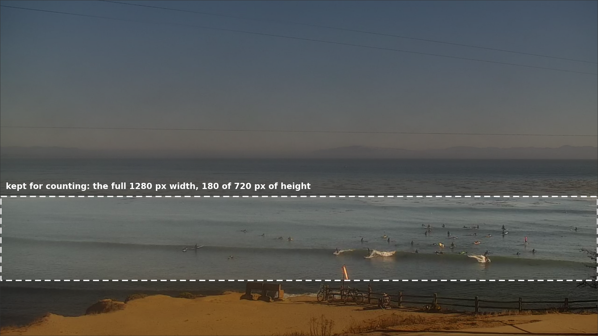

2. **Spot.** A detection model, trained on thousands of surfers labeled by hand, draws a box around every surfer it can find. → [The model](docs/HOW_IT_WORKS.md#the-model-yolov8)

   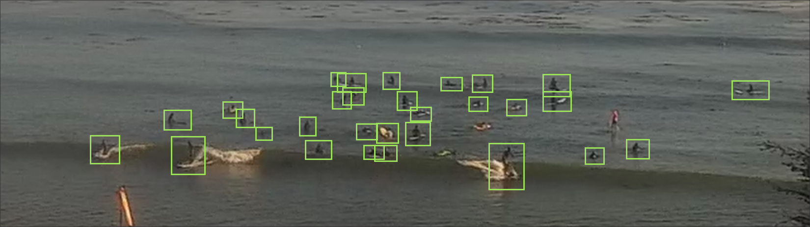

3. **Count.** The boxes become one number per hour from five frames a second apart: their median on near-empty water, their max once 6 or more surfers are out, so a surfer hidden behind a wave in one frame still counts. Frames too dark, foggy or blurry to count are thrown out rather than guessed at. → [Image-quality gate](docs/HOW_IT_WORKS.md#image-quality-gate)

   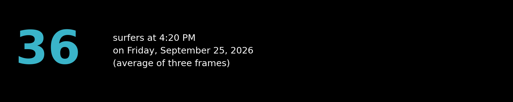

4. **Match.** Tide, swell, wind and weather for that hour are stored next to each count. → [Predictors](docs/HOW_IT_WORKS.md#predictors-weather-tide-swell-wind-energy-consistency)

   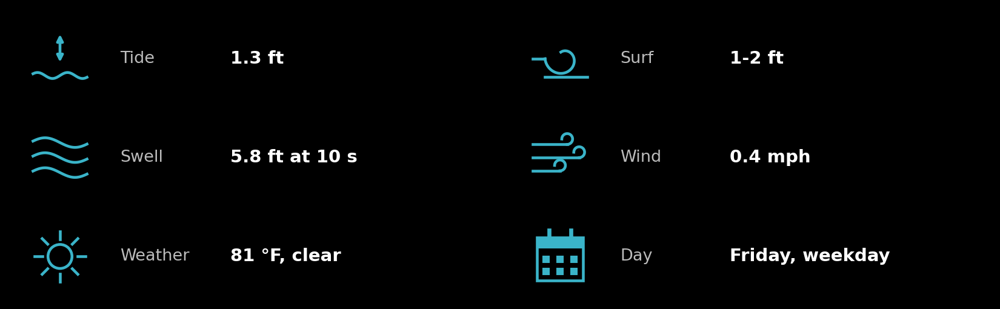

5. **Forecast.** A second model learns which conditions bring people out, then predicts each hour of the coming days with a likely range around each number. The whole thing runs and republishes itself every night. → [Forecast accuracy](docs/HOW_IT_WORKS.md#forecast-accuracy-and-calibration)

   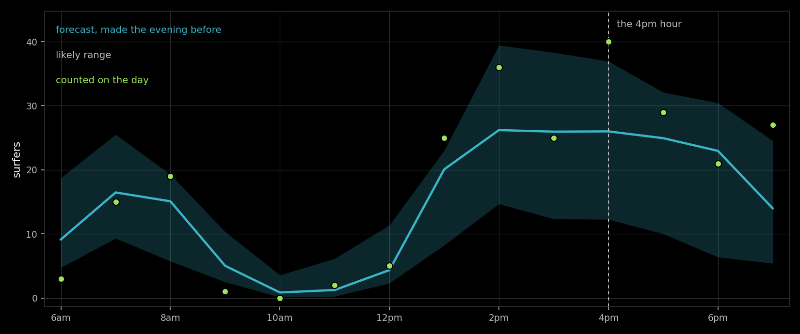

## What the data shows so far

**Tide is by far the biggest driver of the crowd.** The lineup is busiest with the tide between 0 and 3 feet (a typical 23 to 28 surfers), and nearly empty above 4 feet (3 or fewer).

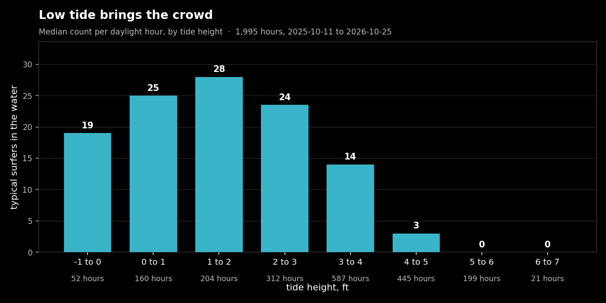

**At low tide, weekends are busier all day.** Between 8am and 5pm, a typical weekend hour has 37 surfers out, against 24 on a weekday. Each cell is the typical count for that hour and day, using only hours with the tide below 3 feet, so the tide doesn't hide the weekly pattern.

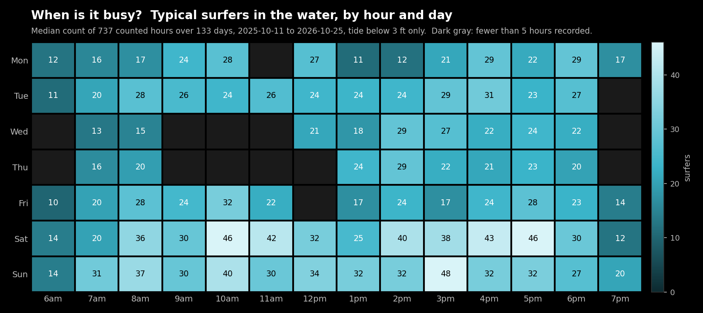

**The weekend effect is stronger in some months than others.** Counting only hours with the tide below 3 feet, weekends ran from about 1.1x as busy as weekdays (October 2025) to 2.0x and 2.5x (November and December 2025, the late-autumn months, when weekday crowds drop off most). October 2026 so far is 1.3x. Several months rest on only two to four low-tide weekend days, so treat single months loosely.

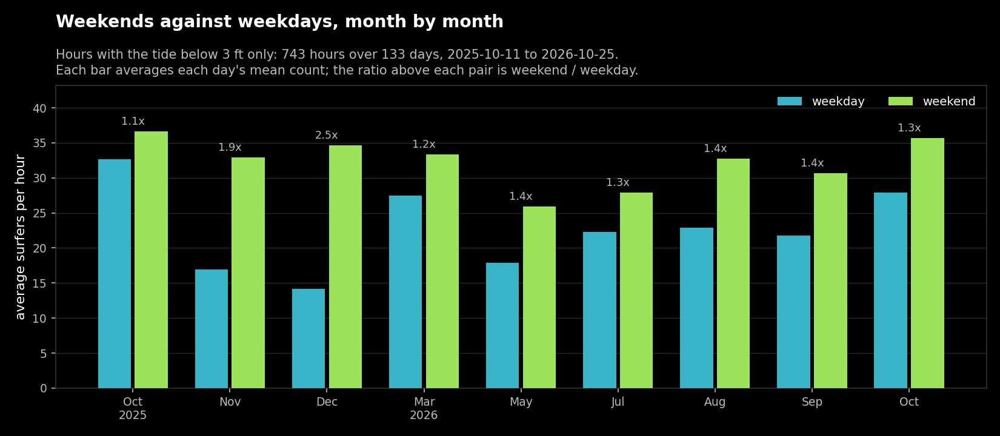

**Crowds thin and empty hours climb into winter.** Four calendar months have never been recorded yet, and the winter 2025 counts came from an earlier version of the object detector.

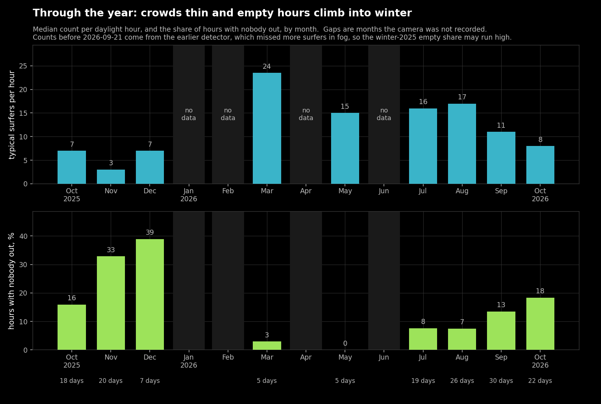

## How accurate is this tool?

### The object detector

**It finds about 9 in 10 surfers, and almost never boxes something that isn't one.** Checked by hand, box by box, on 220 frames from 16 days across a year, holding 3,880 surfers:

| | |
|---|---|
| of the boxes it drew, how many were on a surfer | **98.7%** |
| of the surfers really there, how many it found | **91.9%** |
| average count error | **1.5 surfers** per frame |


Overall it counts about 7% low in a single frame: about 4% low with fewer than 10 surfers out, and 8 to 9% low with 10 to 40. **The hourly count makes up most of that** by looking at five frames a second apart and keeping the highest, since a surfer hidden behind a wave in one frame is usually visible in another. Against the same hand counts, the hour's count is within about 0.3 surfers at every crowd size, where averaging three frames ran 2.8 low with 31 or more out. **Surfers lying flat on their boards (paddling) are the hardest for the object detector to spot**: two out of three misses were surfers in a flat position, and only 10 of 316 were standing.

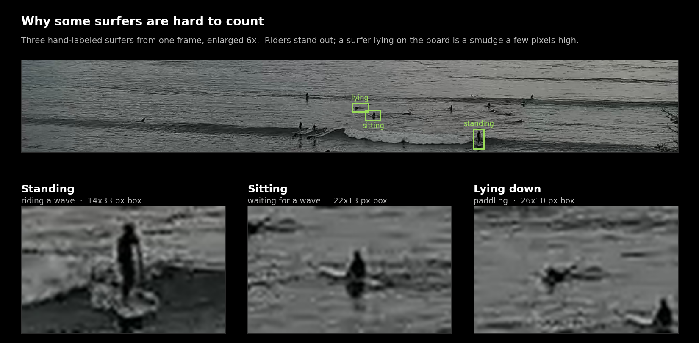

### The forecast

**The night before, it typically misses by about 5 surfers in an hour.** Over 417 scored hours, the average miss was 5.6 surfers, and 58% of hours were within 5. The 80% likely range held the actual count 80% of the time. A forecast a week out is a little worse.

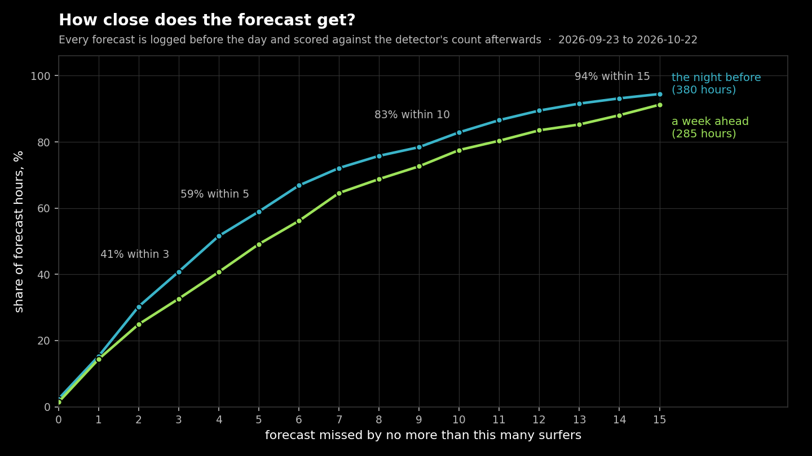


*Above is the most recently scored day (rebuilt each night): the blue line is what was forecast the evening before, the coral line is what the object detector counted, and the dashed green line is the tide.*

**Recent improvements (October 2026).** The likely range now handles quiet hours better, using a model that first asks whether anyone will be out at all. The forecast also corrects itself each night against its own scored record. Both started on October 21 and 22, so the numbers above include only a day or two of them. Details are in [how it works](docs/HOW_IT_WORKS.md#forecast-accuracy-and-calibration).

## Limits and missing data

- **One season of forecasts scored.** The forecast uses data starting in fall of 2025, but has only been scored starting in autumn of 2026, and four calendar months (January, February, April and June) have never been recorded at all, but new counts are being added daily, so every month should be represented by June of 2027.
- **The forecast is scored against the object detector, not a person.** Since the object detector runs about 7% low, so does the yardstick.
- **One camera.** It sees just one break in Santa Cruz of many.
- **Missing predictors.** Holidays, school calendars, local events and contests all bring people out, and none are in the model yet.
- **What would help most:** more hand-labeled frames of crowded lineups and lying-down surfers, and better forecasts of empty hours as winter arrives.

## What's next

- **Surf-quality metrics that include the crowd.** For example, the number of waves per surfer, or a "worth it" score that combines the surf rating with the crowd level. Surfline's rating alone barely separates the crowd at this break:

  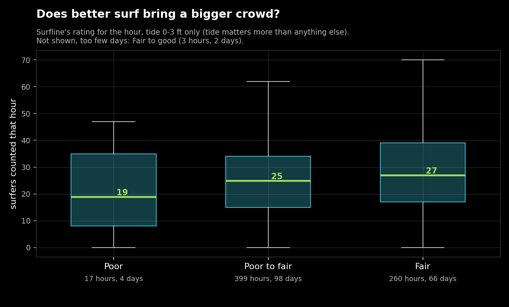

- **Standing surfers per hour, as a measure of rides.** This needs a small second model that tells standing surfers from sitting and lying ones. The poses are already in the hand labels, but the current object detector finds only "surfer."
- **Other spots.** Try the object detector on other cameras, and measure how much relabeling each one needs.
- **Share it with surfers.** Is this useful to you? [Open an issue](https://github.com/jf-silverman/sum-surfers/issues) and tell me.

## Try it yourself

None of these needs an account or a token. Set up once:

```bash
python3 -m venv .venv && source .venv/bin/activate
pip install -r docs/requirements.txt
```

- **Count surfers on the live camera:** `python code/watch_live.py --once` (needs [ffmpeg](https://ffmpeg.org/))
- **Run the object detector on 20 hand-labeled test frames:** `python code/eval_detector.py --coco-dir data/demo --split test --skip-tile-metrics`
- **Check the forecast model on days it never saw:** `python code/eval_surf_count_model.py`

The full setup, including the scheduled pipeline, environment variables and where the data lives, is in [SETUP.md](docs/SETUP.md).

## Learn more

- [How it works](docs/HOW_IT_WORKS.md): the pipeline step by step, both models, accuracy in depth, and a glossary
- [Model card](MODEL_CARD.md): intended use, measured performance and failure modes for both models
- [Project history](docs/PROJECT_HISTORY.md): how it was built, tested and tuned, in order
- [What isn't a surfer](docs/non_surfer_objects.md): the birds, glare and wind socks that fool the object detector
- [Works cited](docs/works_cited.md): the research this project draws on
- [Project files](docs/PROJECT_FILES.md): what every script and folder is for

## License and acknowledgements

The **code** is [GNU AGPL v3.0](LICENSE), and the **data and model weights** are [CC BY-SA 4.0](LICENSE-DATA). The camera footage belongs to Surfline and is not redistributed here. See [LICENSE-DATA](LICENSE-DATA) for the full breakdown.

Thanks to [Surfline](https://www.surfline.com/) for the camera and forecast data, [Open-Meteo](https://open-meteo.com/) for observed weather, [NOAA](https://tidesandcurrents.noaa.gov/) for tides, [Ultralytics](https://github.com/ultralytics/ultralytics) for YOLOv8, and [CVAT](https://www.cvat.ai/) for the labeling tool.
