# Biggest under-forecasts on crowded hours

Generated by `make_forecast_miss_review.py`. The ten crowded hours (30+) where the logged day-ahead forecast fell furthest short, one per day. Frames are the five one-second crops the hourly count uses (median below 6, max from 6 up). Boxes redrawn with the production detector at 2 px and 50% opacity; the label is the boxes drawn. Click a frame for full size; "clean" opens the crop without boxes (local only, crops are not in git).

## 1. 2026-10-10 16:38 (Sat)

Counted 65, forecast 30.2, miss -34.8

0.5 s: [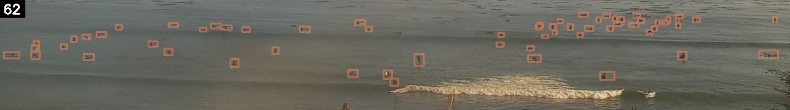](images/boxes_crop2026-10-10_16-38-00_t05.jpg) [clean](../../data/j_shore_cam/surf_crops/crop2026-10-10_16-38-00_t05.jpg)  
1.5 s: [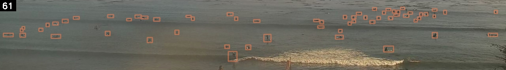](images/boxes_crop2026-10-10_16-38-00_t15.jpg) [clean](../../data/j_shore_cam/surf_crops/crop2026-10-10_16-38-00_t15.jpg)  
2.5 s: [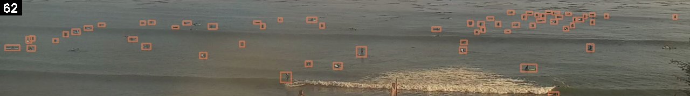](images/boxes_crop2026-10-10_16-38-00.jpg) [clean](../../data/j_shore_cam/surf_crops/crop2026-10-10_16-38-00.jpg)  
3.5 s: [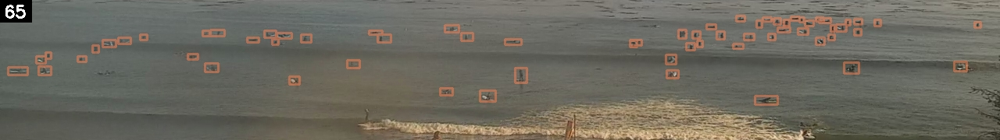](images/boxes_crop2026-10-10_16-38-00_t35.jpg) [clean](../../data/j_shore_cam/surf_crops/crop2026-10-10_16-38-00_t35.jpg)  
4.5 s: [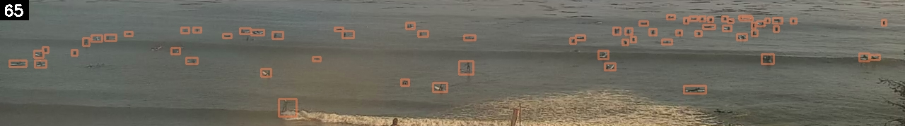](images/boxes_crop2026-10-10_16-38-00_t45.jpg) [clean](../../data/j_shore_cam/surf_crops/crop2026-10-10_16-38-00_t45.jpg)  

## 2. 2026-10-15 17:32 (Thu)

Counted 59, forecast 26.7, miss -32.3

0.5 s: [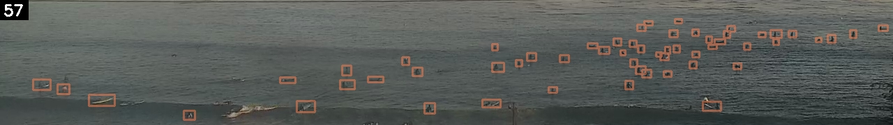](images/boxes_crop2026-10-15_17-32-00_t05.jpg) [clean](../../data/j_shore_cam/surf_crops/crop2026-10-15_17-32-00_t05.jpg)  
1.5 s: [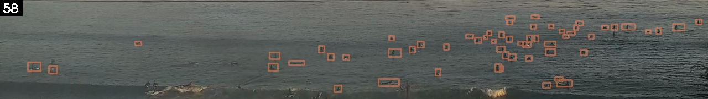](images/boxes_crop2026-10-15_17-32-00_t15.jpg) [clean](../../data/j_shore_cam/surf_crops/crop2026-10-15_17-32-00_t15.jpg)  
2.5 s: [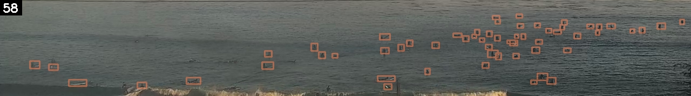](images/boxes_crop2026-10-15_17-32-00.jpg) [clean](../../data/j_shore_cam/surf_crops/crop2026-10-15_17-32-00.jpg)  
3.5 s: [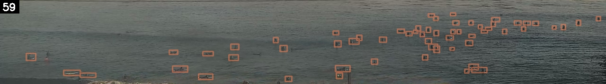](images/boxes_crop2026-10-15_17-32-00_t35.jpg) [clean](../../data/j_shore_cam/surf_crops/crop2026-10-15_17-32-00_t35.jpg)  
4.5 s: [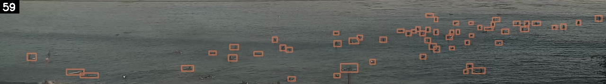](images/boxes_crop2026-10-15_17-32-00_t45.jpg) [clean](../../data/j_shore_cam/surf_crops/crop2026-10-15_17-32-00_t45.jpg)  

## 3. 2026-10-16 17:32 (Fri)

Counted 46, forecast 20.6, miss -25.4

0.5 s:  [clean](../../data/j_shore_cam/surf_crops/crop2026-10-16_17-32-00_t05.jpg)  
1.5 s:  [clean](../../data/j_shore_cam/surf_crops/crop2026-10-16_17-32-00_t15.jpg)  
2.5 s:  [clean](../../data/j_shore_cam/surf_crops/crop2026-10-16_17-32-00.jpg)  
3.5 s:  [clean](../../data/j_shore_cam/surf_crops/crop2026-10-16_17-32-00_t35.jpg)  
4.5 s:  [clean](../../data/j_shore_cam/surf_crops/crop2026-10-16_17-32-00_t45.jpg)  

## 4. 2026-10-13 15:44 (Tue)

Counted 48, forecast 24.9, miss -23.1

0.5 s: [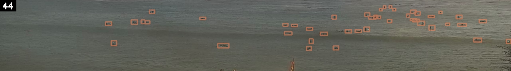](images/boxes_crop2026-10-13_15-44-00_t05.jpg) [clean](../../data/j_shore_cam/surf_crops/crop2026-10-13_15-44-00_t05.jpg)  
1.5 s: [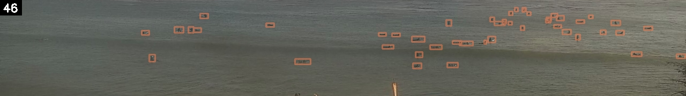](images/boxes_crop2026-10-13_15-44-00_t15.jpg) [clean](../../data/j_shore_cam/surf_crops/crop2026-10-13_15-44-00_t15.jpg)  
2.5 s: [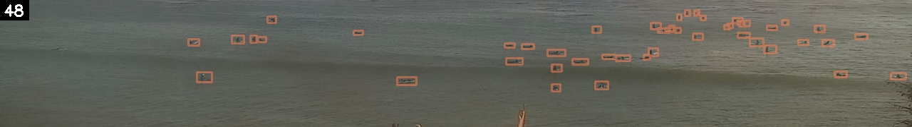](images/boxes_crop2026-10-13_15-44-00.jpg) [clean](../../data/j_shore_cam/surf_crops/crop2026-10-13_15-44-00.jpg)  
3.5 s: [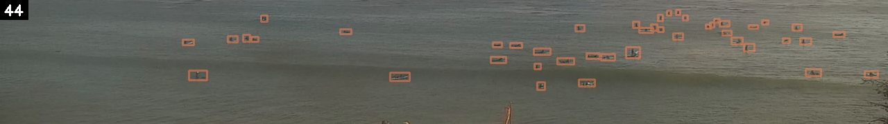](images/boxes_crop2026-10-13_15-44-00_t35.jpg) [clean](../../data/j_shore_cam/surf_crops/crop2026-10-13_15-44-00_t35.jpg)  
4.5 s: [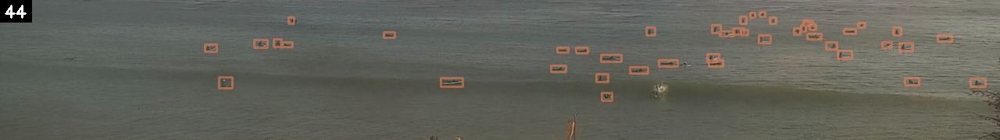](images/boxes_crop2026-10-13_15-44-00_t45.jpg) [clean](../../data/j_shore_cam/surf_crops/crop2026-10-13_15-44-00_t45.jpg)  

## 5. 2026-10-09 15:44 (Fri)

Counted 50, forecast 28.0, miss -22.0

0.5 s: [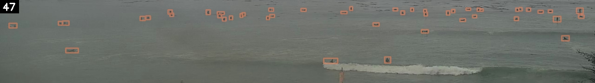](images/boxes_crop2026-10-09_15-44-00_t05.jpg) [clean](../../data/j_shore_cam/surf_crops/crop2026-10-09_15-44-00_t05.jpg)  
1.5 s: [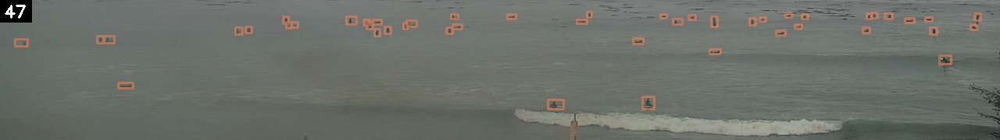](images/boxes_crop2026-10-09_15-44-00_t15.jpg) [clean](../../data/j_shore_cam/surf_crops/crop2026-10-09_15-44-00_t15.jpg)  
2.5 s: [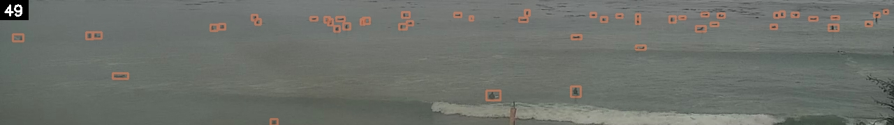](images/boxes_crop2026-10-09_15-44-00.jpg) [clean](../../data/j_shore_cam/surf_crops/crop2026-10-09_15-44-00.jpg)  
3.5 s: [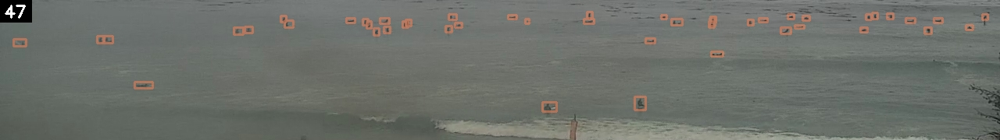](images/boxes_crop2026-10-09_15-44-00_t35.jpg) [clean](../../data/j_shore_cam/surf_crops/crop2026-10-09_15-44-00_t35.jpg)  
4.5 s: [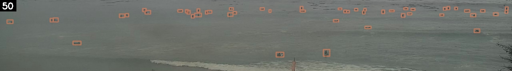](images/boxes_crop2026-10-09_15-44-00_t45.jpg) [clean](../../data/j_shore_cam/surf_crops/crop2026-10-09_15-44-00_t45.jpg)  

## 6. 2026-10-11 14:50 (Sun)

Counted 42, forecast 21.9, miss -20.1

0.5 s: [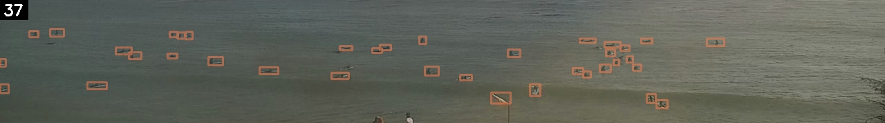](images/boxes_crop2026-10-11_14-50-00_t05.jpg) [clean](../../data/j_shore_cam/surf_crops/crop2026-10-11_14-50-00_t05.jpg)  
1.5 s: [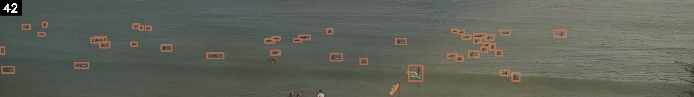](images/boxes_crop2026-10-11_14-50-00_t15.jpg) [clean](../../data/j_shore_cam/surf_crops/crop2026-10-11_14-50-00_t15.jpg)  
2.5 s:  [clean](../../data/j_shore_cam/surf_crops/crop2026-10-11_14-50-00.jpg)  
3.5 s:  [clean](../../data/j_shore_cam/surf_crops/crop2026-10-11_14-50-00_t35.jpg)  
4.5 s:  [clean](../../data/j_shore_cam/surf_crops/crop2026-10-11_14-50-00_t45.jpg)  

## 7. 2026-10-12 17:32 (Mon)

Counted 44, forecast 24.4, miss -19.6

0.5 s: [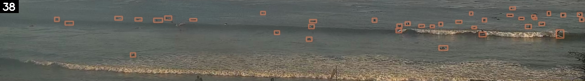](images/boxes_crop2026-10-12_17-32-00_t05.jpg) [clean](../../data/j_shore_cam/surf_crops/crop2026-10-12_17-32-00_t05.jpg)  
1.5 s: [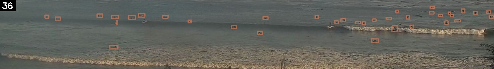](images/boxes_crop2026-10-12_17-32-00_t15.jpg) [clean](../../data/j_shore_cam/surf_crops/crop2026-10-12_17-32-00_t15.jpg)  
2.5 s: [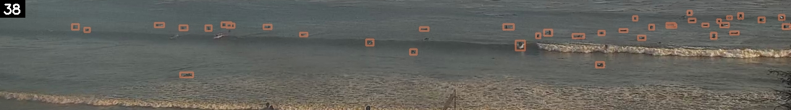](images/boxes_crop2026-10-12_17-32-00.jpg) [clean](../../data/j_shore_cam/surf_crops/crop2026-10-12_17-32-00.jpg)  
3.5 s: [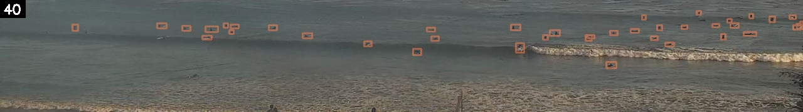](images/boxes_crop2026-10-12_17-32-00_t35.jpg) [clean](../../data/j_shore_cam/surf_crops/crop2026-10-12_17-32-00_t35.jpg)  
4.5 s: [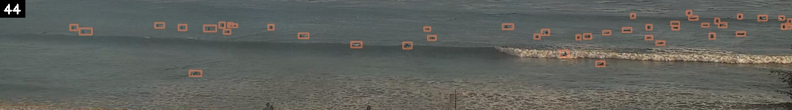](images/boxes_crop2026-10-12_17-32-00_t45.jpg) [clean](../../data/j_shore_cam/surf_crops/crop2026-10-12_17-32-00_t45.jpg)  

## 8. 2026-10-24 17:41 (Sat)

Counted 47, forecast 27.4, miss -19.6

0.5 s: [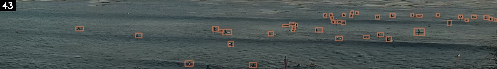](images/boxes_crop2026-10-24_17-41-00_t05.jpg) [clean](../../data/j_shore_cam/surf_crops/crop2026-10-24_17-41-00_t05.jpg)  
1.5 s: [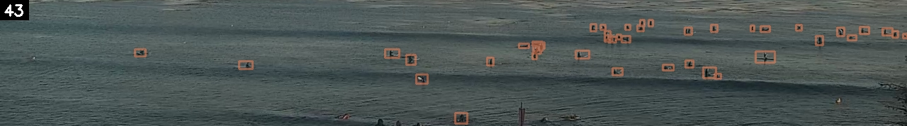](images/boxes_crop2026-10-24_17-41-00_t15.jpg) [clean](../../data/j_shore_cam/surf_crops/crop2026-10-24_17-41-00_t15.jpg)  
2.5 s: [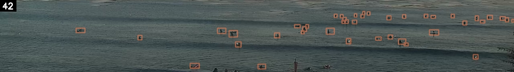](images/boxes_crop2026-10-24_17-41-00.jpg) [clean](../../data/j_shore_cam/surf_crops/crop2026-10-24_17-41-00.jpg)  
3.5 s: [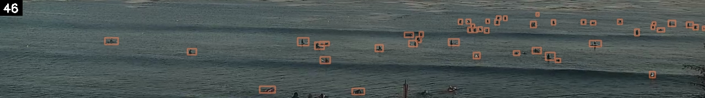](images/boxes_crop2026-10-24_17-41-00_t35.jpg) [clean](../../data/j_shore_cam/surf_crops/crop2026-10-24_17-41-00_t35.jpg)  
4.5 s: [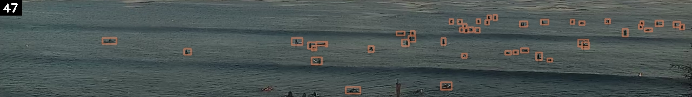](images/boxes_crop2026-10-24_17-41-00_t45.jpg) [clean](../../data/j_shore_cam/surf_crops/crop2026-10-24_17-41-00_t45.jpg)  

## 9. 2026-10-23 15:53 (Fri)

Counted 48, forecast 29.4, miss -18.6

0.5 s: [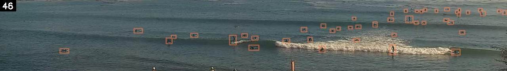](images/boxes_crop2026-10-23_15-53-00_t05.jpg) [clean](../../data/j_shore_cam/surf_crops/crop2026-10-23_15-53-00_t05.jpg)  
1.5 s: [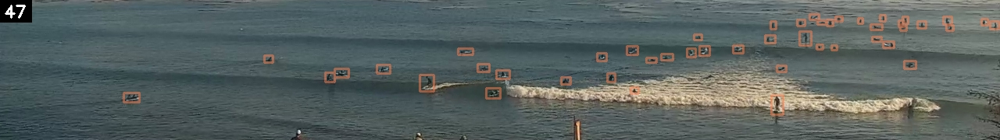](images/boxes_crop2026-10-23_15-53-00_t15.jpg) [clean](../../data/j_shore_cam/surf_crops/crop2026-10-23_15-53-00_t15.jpg)  
2.5 s: [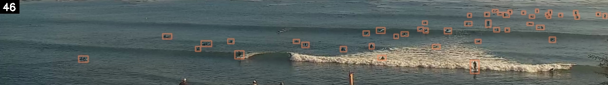](images/boxes_crop2026-10-23_15-53-00.jpg) [clean](../../data/j_shore_cam/surf_crops/crop2026-10-23_15-53-00.jpg)  
3.5 s: [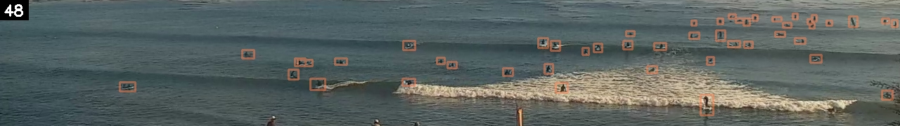](images/boxes_crop2026-10-23_15-53-00_t35.jpg) [clean](../../data/j_shore_cam/surf_crops/crop2026-10-23_15-53-00_t35.jpg)  
4.5 s: [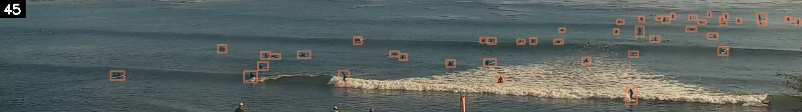](images/boxes_crop2026-10-23_15-53-00_t45.jpg) [clean](../../data/j_shore_cam/surf_crops/crop2026-10-23_15-53-00_t45.jpg)  

## 10. 2026-10-25 15:53 (Sun)

Counted 48, forecast 30.1, miss -17.9

0.5 s: [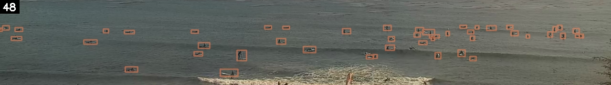](images/boxes_crop2026-10-25_15-53-00_t05.jpg) [clean](../../data/j_shore_cam/surf_crops/crop2026-10-25_15-53-00_t05.jpg)  
1.5 s: [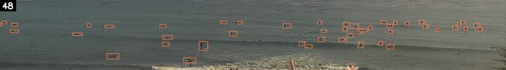](images/boxes_crop2026-10-25_15-53-00_t15.jpg) [clean](../../data/j_shore_cam/surf_crops/crop2026-10-25_15-53-00_t15.jpg)  
2.5 s: [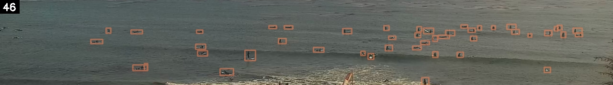](images/boxes_crop2026-10-25_15-53-00.jpg) [clean](../../data/j_shore_cam/surf_crops/crop2026-10-25_15-53-00.jpg)  
3.5 s: [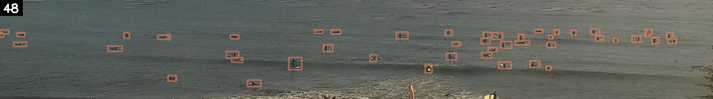](images/boxes_crop2026-10-25_15-53-00_t35.jpg) [clean](../../data/j_shore_cam/surf_crops/crop2026-10-25_15-53-00_t35.jpg)  
4.5 s: [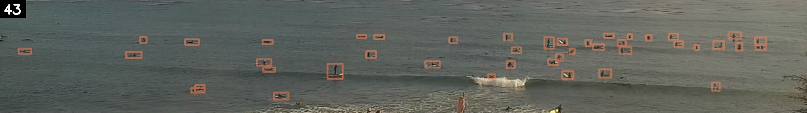](images/boxes_crop2026-10-25_15-53-00_t45.jpg) [clean](../../data/j_shore_cam/surf_crops/crop2026-10-25_15-53-00_t45.jpg)  

## All ten

| # | Date and time | Five frames (0.5-4.5 s) | Counted | Forecast | Miss (forecast minus actual) | Forecast range (10-90%) | Day | Weekend | Holiday / long weekend | Month | Surfline rating (0-6) | Tide (ft) | Surf height min (ft) | Surf height max (ft) | Primary swell height (ft) | Primary swell period (s) | Primary swell direction (deg) | Wind speed (mph) | Wind gust (mph) | Wind direction (deg) | Swell energy offshore (kJ) | Swell energy nearshore (kJ) | Wave consistency (waves) | Surfline weather | Weather group | Surfline air temp (F) | Surfline pressure (mb) | Observed air temp (F) | Observed humidity (%) | Observed cloud cover (%) | Observed pressure (mb) | Daylight hours with tide under 3.5 ft | Share of daylight with tide under 3.5 ft | Hours under 3.5 ft left today |
|---|---|---|---|---|---|---|---|---|---|---|---|---|---|---|---|---|---|---|---|---|---|---|---|---|---|---|---|---|---|---|---|---|---|---|
| 1 | 2026-10-10 16:38 | 62 / 61 / 62 / 65 / 65 | 65 | 30.2 | -34.8 | 8-45 | Sat | True |  | 10 | 3 | 0.45 | 2 | 3 | 9.5 | 10 | 305.7 | 10.2 | 12.83 | 318.9 | 1750.4 | 361 | 35.68 | CLEAR | CLEAR | 68.7 | 1003 | 71.8 | 45 | 1 | 1001.1 | 7 | 0.54 | 3 |
| 2 | 2026-10-15 17:32 | 57 / 58 / 58 / 59 / 59 | 59 | 26.7 | -32.3 | 0-38 | Thu | False |  | 10 | 3 | 2.53 | 2 | 3 | 3.5 | 14 | 200.8 | 6.46 | 7 | 275.2 | 762.2 | 334.1 | 31.95 | CLEAR | CLEAR | 78.9 | 1017 | 83.5 | 28 | 0 | 1015.7 | 4 | 0.33 | 2 |
| 3 | 2026-10-16 17:32 | 43 / 46 / 44 / 43 / 43 | 46 | 20.6 | -25.4 | 0-35 | Fri | False |  | 10 | 3 | 3.25 | 2 | 3 | 2.18 | 13 | 199.4 | 2.82 | 3.3 | 246.9 | 550.8 | 232 | 29.48 | CLEAR | CLEAR | 75 | 1017 | 85.8 | 16 | 0 | 1015.2 | 2 | 0.17 | 2 |
| 4 | 2026-10-13 15:44 | 44 / 46 / 48 / 44 / 44 | 48 | 24.9 | -23.1 | 0-43 | Tue | False |  | 10 | 3 | 3.33 | 3 | 4 | 2.51 | 18 | 199.1 | 4.76 | 4.76 | 243 | 1257.1 | 490.9 | 22.12 | CLEAR | CLEAR | 69 | 1017 | 73.8 | 19 | 0 | 1015.4 | 7 | 0.54 | 4 |
| 5 | 2026-10-09 15:44 | 47 / 47 / 49 / 47 / 50 | 50 | 28.0 | -22.0 | 14-39 | Fri | False |  | 10 | 2 | 1.03 | 2 | 3 | 2.64 | 15 | 209.2 | 8.82 | 10.11 | 247.8 | 1268.9 | 400.8 | 35.38 | MOSTLY_CLEAR | CLEAR | 62.5 | 1008 | 64.4 | 76 | 37 | 1007.1 | 8 | 0.62 | 4 |
| 6 | 2026-10-11 14:50 | 37 / 42 / 39 / 35 / 41 | 42 | 21.9 | -20.1 | 6-44 | Sun | True |  | 10 | 2 | 3.31 | 2 | 3 | 10.07 | 10 | 302.1 | 11.78 | 13.41 | 265 | 2098.8 | 297.6 | 34.01 | CLEAR | CLEAR | 63.9 | 1003 | 64.9 | 65 | 26 | 1001.5 | 7 | 0.58 | 5 |
| 7 | 2026-10-12 17:32 | 38 / 36 / 38 / 40 / 44 | 44 | 24.4 | -19.6 | 8-37 | Mon | False |  | 10 | 2 | 0.36 | 2 | 3 | 3.22 | 15 | 207.5 | 11.32 | 14.38 | 277.7 | 1705.8 | 428.1 | 26.4 | CLEAR | CLEAR | 64.4 | 1012 | 65.5 | 57 | 0 | 1011.2 | 7 | 0.54 | 2 |
| 8 | 2026-10-24 17:41 | 43 / 43 / 42 / 46 / 47 | 47 | 27.4 | -19.6 | 17-46 | Sat | True |  | 10 | 2 | 0.46 | 1 | 2 | 2.53 | 15 | 198.5 | 7.3 | 8.55 | 268 | 611.2 | 142.5 | 27.95 | CLEAR | CLEAR | 67.5 | 1015 | 68.7 | 52 | 2 | 1013.8 | 6 | 0.5 | 2 |
| 9 | 2026-10-23 15:53 | 46 / 47 / 46 / 48 / 45 | 48 | 29.4 | -18.6 | 15-35 | Fri | False |  | 10 | 2 | 0.9 | 1 | 2 | 8.15 | 9 | 306.2 | 9.36 | 13.61 | 18.5 | 1179.8 | 215.6 | 30.69 | CLEAR | CLEAR | 70 | 1015 | 70 | 54 | 14 | 1014.8 | 8 | 0.62 | 4 |
| 10 | 2026-10-25 15:53 | 48 / 48 / 46 / 48 / 43 | 48 | 30.1 | -17.9 | 18-45 | Sun | True |  | 10 | 2 | 0.45 | 1 | 2 | 2.47 | 14 | 199.9 | 5.97 | 6.41 | 246.2 | 339.4 | 130.2 | 31.53 | CLEAR | CLEAR | 66.2 | 1017 | 69.1 | 52 | 91 | 1016.7 | 6 | 0.5 | 4 |
