# Crowded hours: forecast accurate against forecast low

Generated by `make_frame_pairs.py`. Forecast = week-held-out hindcast (`packed_hours_oof.csv`). Crowded = 30+ (an accurate hour next to a low one may be 25+); accurate = within 3; low = 10 or more under. Frames are production's three per hour, 1.5 s apart in one clip. Boxes redrawn with the production detector; the label is the boxes drawn, with the recorded count if different. Click a frame for full size; "clean" opens the crop without boxes (local only, crops are not in git).

## Part 1: consecutive hours, same day

### Pair 1: 2026-03-16 (Mon)

**Accurate: 2026-03-16 13:38** (actual 25, hindcast 27.0, miss +2.0)

[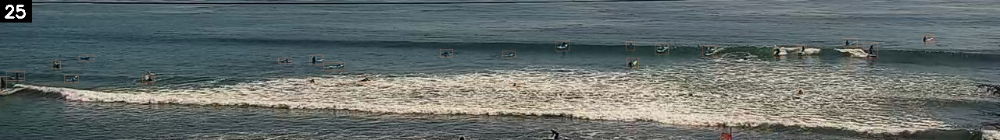](frame_pairs/boxes_crop2026-03-16_13-38-00_side1.jpg) [clean](../../data/j_shore_cam/surf_crops/crop2026-03-16_13-38-00_side1.jpg)  
[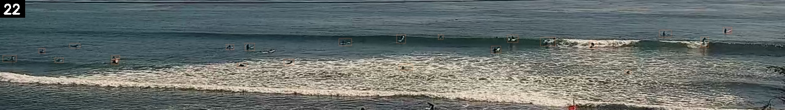](frame_pairs/boxes_crop2026-03-16_13-38-00.jpg) [clean](../../data/j_shore_cam/surf_crops/crop2026-03-16_13-38-00.jpg)  
[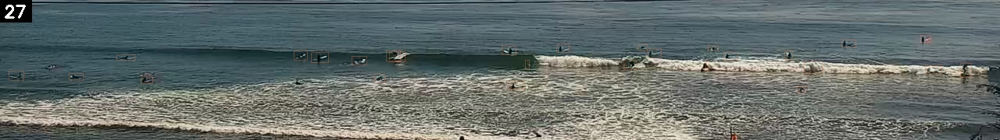](frame_pairs/boxes_crop2026-03-16_13-38-00_side2.jpg) [clean](../../data/j_shore_cam/surf_crops/crop2026-03-16_13-38-00_side2.jpg)  

**Low: 2026-03-16 12:44** (actual 48, hindcast 16.1, miss -31.9)

[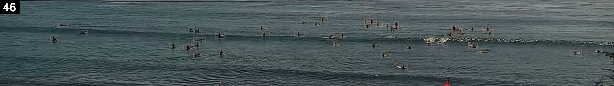](frame_pairs/boxes_crop2026-03-16_12-44-00_side1.jpg) [clean](../../data/j_shore_cam/surf_crops/crop2026-03-16_12-44-00_side1.jpg)  
[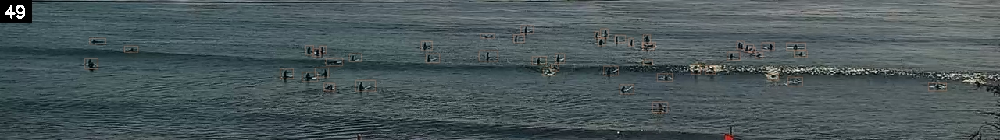](frame_pairs/boxes_crop2026-03-16_12-44-00.jpg) [clean](../../data/j_shore_cam/surf_crops/crop2026-03-16_12-44-00.jpg)  
[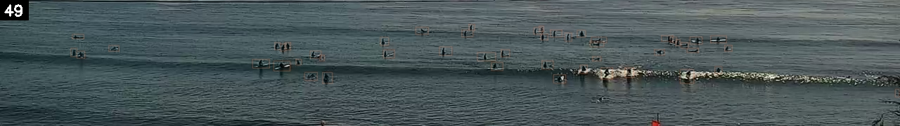](frame_pairs/boxes_crop2026-03-16_12-44-00_side2.jpg) [clean](../../data/j_shore_cam/surf_crops/crop2026-03-16_12-44-00_side2.jpg)  

| Hour | Frames (1.0 s, 2.5 s, 4.0 s) | 3-frame average | Counted (rounded) | Hindcast | Miss (hindcast minus actual) | Date | Time | Day | Weekend | Holiday / long weekend | Month | Surfline rating (0-6) | Tide (ft) | Surf height min (ft) | Surf height max (ft) | Primary swell height (ft) | Primary swell period (s) | Primary swell direction (deg) | Wind speed (mph) | Wind gust (mph) | Wind direction (deg) | Swell energy offshore (kJ) | Swell energy nearshore (kJ) | Wave consistency (waves) | Surfline weather | Weather group | Surfline air temp (F) | Surfline pressure (mb) | Observed air temp (F) | Observed humidity (%) | Observed cloud cover (%) | Observed pressure (mb) | Daylight hours with tide under 3.5 ft | Share of daylight with tide under 3.5 ft | Hours under 3.5 ft left today |
|---|---|---|---|---|---|---|---|---|---|---|---|---|---|---|---|---|---|---|---|---|---|---|---|---|---|---|---|---|---|---|---|---|---|---|---|
| Accurate | crop2026-03-16_13-38-00_side1.jpg crop2026-03-16_13-38-00.jpg crop2026-03-16_13-38-00_side2.jpg | 24.67 | 25 | 27.0 | +2.0 | 2026-03-16 | 13:38 | Mon | 0 | none | 3 | 2 | 1.88 | 1 | 2 | 1.59 | 18 | 203.6 | 3.04 | 3.04 | 237.5 | 461.8 | 124.2 | 24.53 | CLEAR | CLEAR | 77.8 | 1018 | 78.8 | 65 | 91 | 1016.5 | 8 | 0.67 | 7 |
| Low | crop2026-03-16_12-44-00_side1.jpg crop2026-03-16_12-44-00.jpg crop2026-03-16_12-44-00_side2.jpg | 48 | 48 | 16.1 | -31.9 | 2026-03-16 | 12:44 | Mon | 0 | none | 3 | 2 | 3.08 | 1 | 2 | 1.6 | 19 | 181.7 | 2.45 | 2.45 | 248.2 | 475.9 | 125.1 | 24.62 | CLEAR | CLEAR | 75.1 | 1018 | 78.1 | 58 | 96 | 1016.9 | 8 | 0.67 | 8 |

### Pair 2: 2026-09-05 (Sat)

**Accurate: 2026-09-05 12:26** (actual 28, hindcast 29.0, miss +1.0)

[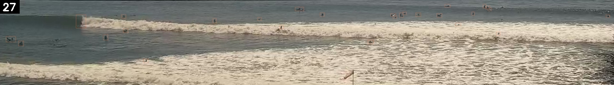](frame_pairs/boxes_crop2026-09-05_12-26-00_side1.jpg) [clean](../../data/j_shore_cam/surf_crops/crop2026-09-05_12-26-00_side1.jpg)  
[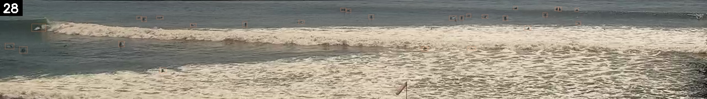](frame_pairs/boxes_crop2026-09-05_12-26-00.jpg) [clean](../../data/j_shore_cam/surf_crops/crop2026-09-05_12-26-00.jpg)  
[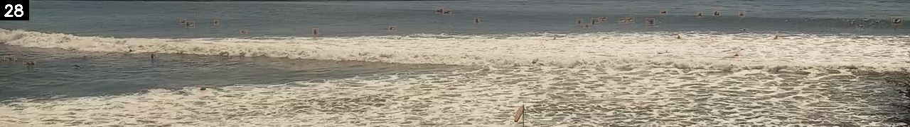](frame_pairs/boxes_crop2026-09-05_12-26-00_side2.jpg) [clean](../../data/j_shore_cam/surf_crops/crop2026-09-05_12-26-00_side2.jpg)  

**Low: 2026-09-05 11:32** (actual 56, hindcast 32.6, miss -23.4)

[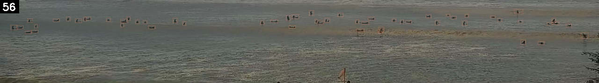](frame_pairs/boxes_crop2026-09-05_11-32-00_side1.jpg) [clean](../../data/j_shore_cam/surf_crops/crop2026-09-05_11-32-00_side1.jpg)  
[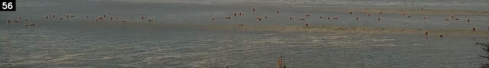](frame_pairs/boxes_crop2026-09-05_11-32-00.jpg) [clean](../../data/j_shore_cam/surf_crops/crop2026-09-05_11-32-00.jpg)  
[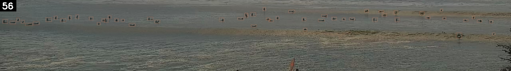](frame_pairs/boxes_crop2026-09-05_11-32-00_side2.jpg) [clean](../../data/j_shore_cam/surf_crops/crop2026-09-05_11-32-00_side2.jpg)  

| Hour | Frames (1.0 s, 2.5 s, 4.0 s) | 3-frame average | Counted (rounded) | Hindcast | Miss (hindcast minus actual) | Date | Time | Day | Weekend | Holiday / long weekend | Month | Surfline rating (0-6) | Tide (ft) | Surf height min (ft) | Surf height max (ft) | Primary swell height (ft) | Primary swell period (s) | Primary swell direction (deg) | Wind speed (mph) | Wind gust (mph) | Wind direction (deg) | Swell energy offshore (kJ) | Swell energy nearshore (kJ) | Wave consistency (waves) | Surfline weather | Weather group | Surfline air temp (F) | Surfline pressure (mb) | Observed air temp (F) | Observed humidity (%) | Observed cloud cover (%) | Observed pressure (mb) | Daylight hours with tide under 3.5 ft | Share of daylight with tide under 3.5 ft | Hours under 3.5 ft left today |
|---|---|---|---|---|---|---|---|---|---|---|---|---|---|---|---|---|---|---|---|---|---|---|---|---|---|---|---|---|---|---|---|---|---|---|---|
| Accurate | crop2026-09-05_12-26-00_side1.jpg crop2026-09-05_12-26-00.jpg crop2026-09-05_12-26-00_side2.jpg | 27.67 | 28 | 29.0 | +1.0 | 2026-09-05 | 12:26 | Sat | 1 | long weekend | 9 | 3 | 3.43 | 2 | 3 | 3.13 | 16 | 206.8 | 6.3 | 6.3 | 233.7 | 1121.5 | 350.6 | 29.86 | CLEAR | CLEAR | 70.8 | 1015 | 70.9 | 58 | 5 | 1013.8 | 4 | 0.29 | 1 |
| Low | crop2026-09-05_11-32-00_side1.jpg crop2026-09-05_11-32-00.jpg crop2026-09-05_11-32-00_side2.jpg | 56 | 56 | 32.6 | -23.4 | 2026-09-05 | 11:32 | Sat | 1 | long weekend | 9 | 3 | 3.42 | 2 | 3 | 3.18 | 16 | 204.5 | 3.75 | 3.75 | 248.6 | 1124.1 | 349.7 | 29.59 | CLEAR | CLEAR | 63.9 | 1015 | 68.7 | 61 | 38 | 1014 | 4 | 0.29 | 2 |

### Pair 3: 2026-08-23 (Sun)

**Accurate: 2026-08-23 12:08** (actual 28, hindcast 25.0, miss -3.0)

[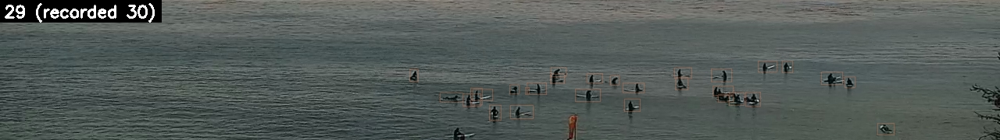](frame_pairs/boxes_crop2026-08-23_12-08-00_side1.jpg) [clean](../../data/j_shore_cam/surf_crops/crop2026-08-23_12-08-00_side1.jpg)  
[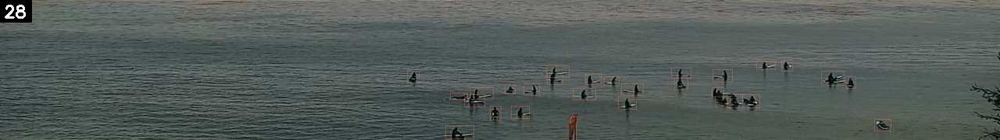](frame_pairs/boxes_crop2026-08-23_12-08-00.jpg) [clean](../../data/j_shore_cam/surf_crops/crop2026-08-23_12-08-00.jpg)  
[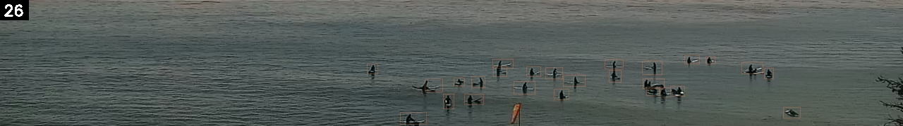](frame_pairs/boxes_crop2026-08-23_12-08-00_side2.jpg) [clean](../../data/j_shore_cam/surf_crops/crop2026-08-23_12-08-00_side2.jpg)  

**Low: 2026-08-23 13:02** (actual 45, hindcast 23.8, miss -21.2)

[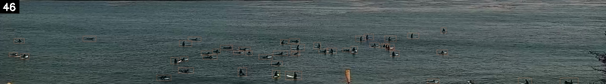](frame_pairs/boxes_crop2026-08-23_13-02-00_side1.jpg) [clean](../../data/j_shore_cam/surf_crops/crop2026-08-23_13-02-00_side1.jpg)  
[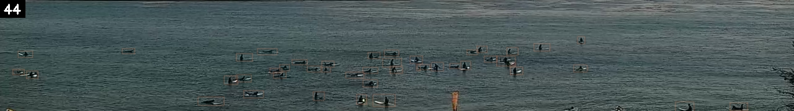](frame_pairs/boxes_crop2026-08-23_13-02-00.jpg) [clean](../../data/j_shore_cam/surf_crops/crop2026-08-23_13-02-00.jpg)  
[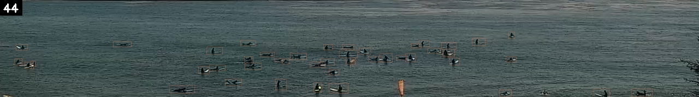](frame_pairs/boxes_crop2026-08-23_13-02-00_side2.jpg) [clean](../../data/j_shore_cam/surf_crops/crop2026-08-23_13-02-00_side2.jpg)  

| Hour | Frames (1.0 s, 2.5 s, 4.0 s) | 3-frame average | Counted (rounded) | Hindcast | Miss (hindcast minus actual) | Date | Time | Day | Weekend | Holiday / long weekend | Month | Surfline rating (0-6) | Tide (ft) | Surf height min (ft) | Surf height max (ft) | Primary swell height (ft) | Primary swell period (s) | Primary swell direction (deg) | Wind speed (mph) | Wind gust (mph) | Wind direction (deg) | Swell energy offshore (kJ) | Swell energy nearshore (kJ) | Wave consistency (waves) | Surfline weather | Weather group | Surfline air temp (F) | Surfline pressure (mb) | Observed air temp (F) | Observed humidity (%) | Observed cloud cover (%) | Observed pressure (mb) | Daylight hours with tide under 3.5 ft | Share of daylight with tide under 3.5 ft | Hours under 3.5 ft left today |
|---|---|---|---|---|---|---|---|---|---|---|---|---|---|---|---|---|---|---|---|---|---|---|---|---|---|---|---|---|---|---|---|---|---|---|---|
| Accurate | crop2026-08-23_12-08-00_side1.jpg crop2026-08-23_12-08-00.jpg crop2026-08-23_12-08-00_side2.jpg | 28 | 28 | 25.0 | -3.0 | 2026-08-23 | 12:08 | Sun | 1 | none | 8 | 2 | 3.57 | 0 | 1 | 4.65 | 7 | 305.8 | 5.67 | 5.67 | 221.5 | 342.7 | 88.8 | 33.5 | CLEAR | CLEAR | 70.8 | 1015 | 73.9 | 57 | 91 | 1013.3 | 6 | 0.43 | 3 |
| Low | crop2026-08-23_13-02-00_side1.jpg crop2026-08-23_13-02-00.jpg crop2026-08-23_13-02-00_side2.jpg | 44.67 | 45 | 23.8 | -21.2 | 2026-08-23 | 13:02 | Sun | 1 | none | 8 | 2 | 3.4 | 0 | 1 | 4.74 | 7 | 305.5 | 5.99 | 6.93 | 223.5 | 349.9 | 88.6 | 33.56 | CLEAR | CLEAR | 74.8 | 1014 | 75.2 | 55 | 77 | 1012.7 | 6 | 0.43 | 3 |

### Pair 4: 2026-10-24 (Sat)

**Accurate: 2026-10-24 13:11** (actual 36, hindcast 34.8, miss -1.2)

[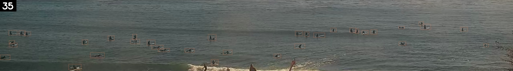](frame_pairs/boxes_crop2026-10-24_13-11-00_side1.jpg) [clean](../../data/j_shore_cam/surf_crops/crop2026-10-24_13-11-00_side1.jpg)  
[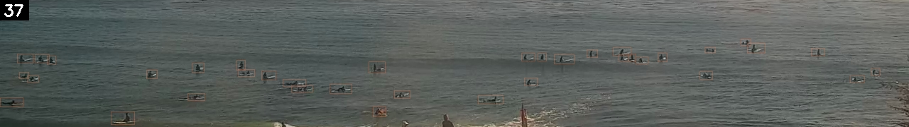](frame_pairs/boxes_crop2026-10-24_13-11-00.jpg) [clean](../../data/j_shore_cam/surf_crops/crop2026-10-24_13-11-00.jpg)  
[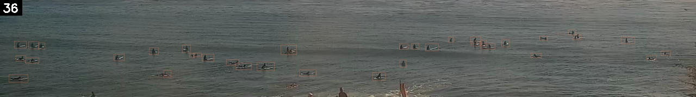](frame_pairs/boxes_crop2026-10-24_13-11-00_side2.jpg) [clean](../../data/j_shore_cam/surf_crops/crop2026-10-24_13-11-00_side2.jpg)  

**Low: 2026-10-24 14:05** (actual 52, hindcast 32.1, miss -19.9)

[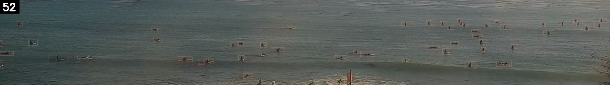](frame_pairs/boxes_crop2026-10-24_14-05-00_side1.jpg) [clean](../../data/j_shore_cam/surf_crops/crop2026-10-24_14-05-00_side1.jpg)  
[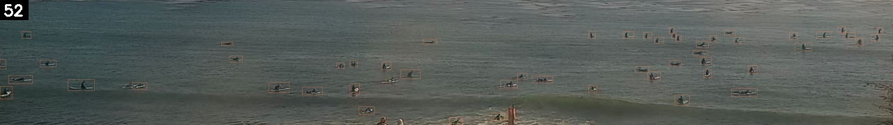](frame_pairs/boxes_crop2026-10-24_14-05-00.jpg) [clean](../../data/j_shore_cam/surf_crops/crop2026-10-24_14-05-00.jpg)  
[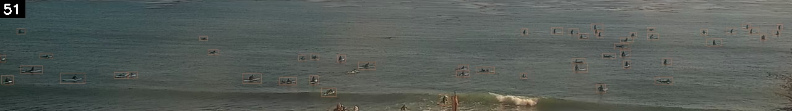](frame_pairs/boxes_crop2026-10-24_14-05-00_side2.jpg) [clean](../../data/j_shore_cam/surf_crops/crop2026-10-24_14-05-00_side2.jpg)  

| Hour | Frames (1.0 s, 2.5 s, 4.0 s) | 3-frame average | Counted (rounded) | Hindcast | Miss (hindcast minus actual) | Date | Time | Day | Weekend | Holiday / long weekend | Month | Surfline rating (0-6) | Tide (ft) | Surf height min (ft) | Surf height max (ft) | Primary swell height (ft) | Primary swell period (s) | Primary swell direction (deg) | Wind speed (mph) | Wind gust (mph) | Wind direction (deg) | Swell energy offshore (kJ) | Swell energy nearshore (kJ) | Wave consistency (waves) | Surfline weather | Weather group | Surfline air temp (F) | Surfline pressure (mb) | Observed air temp (F) | Observed humidity (%) | Observed cloud cover (%) | Observed pressure (mb) | Daylight hours with tide under 3.5 ft | Share of daylight with tide under 3.5 ft | Hours under 3.5 ft left today |
|---|---|---|---|---|---|---|---|---|---|---|---|---|---|---|---|---|---|---|---|---|---|---|---|---|---|---|---|---|---|---|---|---|---|---|---|
| Accurate | crop2026-10-24_13-11-00_side1.jpg crop2026-10-24_13-11-00.jpg crop2026-10-24_13-11-00_side2.jpg | 36 | 36 | 34.8 | -1.2 | 2026-10-24 | 13:11 | Sat | 1 | none | 10 | 2 | 2.45 | 1 | 2 | 5.73 | 9 | 307.9 | 4.43 | 4.47 | 240 | 691.6 | 132.5 | 30.31 | CLEAR | CLEAR | 66.3 | 1017 | 69.1 | 59 | 1 | 1015.2 | 6 | 0.5 | 6 |
| Low | crop2026-10-24_14-05-00_side1.jpg crop2026-10-24_14-05-00.jpg crop2026-10-24_14-05-00_side2.jpg | 51.67 | 52 | 32.1 | -19.9 | 2026-10-24 | 14:05 | Sat | 1 | none | 10 | 2 | 1.28 | 1 | 2 | 2.54 | 15 | 197.6 | 7.18 | 7.78 | 253.2 | 670.4 | 135.5 | 29.63 | CLEAR | CLEAR | 66.1 | 1015 | 69.6 | 59 | 1 | 1014.2 | 6 | 0.5 | 5 |

### Pair 5: 2026-07-28 (Tue)

**Accurate: 2026-07-28 15:26** (actual 26, hindcast 23.2, miss -2.8)

[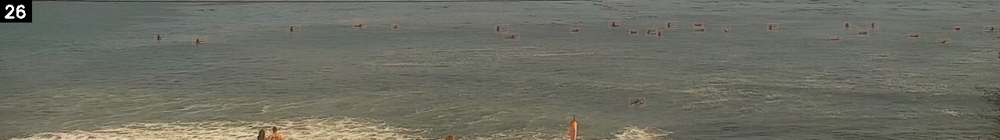](frame_pairs/boxes_crop2026-07-28_15-26-00_side1.jpg) [clean](../../data/j_shore_cam/surf_crops/crop2026-07-28_15-26-00_side1.jpg)  
[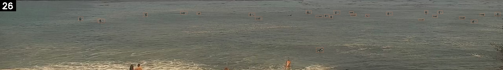](frame_pairs/boxes_crop2026-07-28_15-26-00.jpg) [clean](../../data/j_shore_cam/surf_crops/crop2026-07-28_15-26-00.jpg)  
[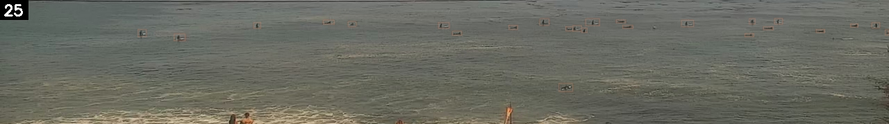](frame_pairs/boxes_crop2026-07-28_15-26-00_side2.jpg) [clean](../../data/j_shore_cam/surf_crops/crop2026-07-28_15-26-00_side2.jpg)  

**Low: 2026-07-28 14:32** (actual 40, hindcast 20.5, miss -19.5)

[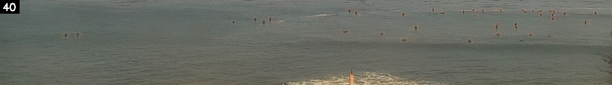](frame_pairs/boxes_crop2026-07-28_14-32-00_side1.jpg) [clean](../../data/j_shore_cam/surf_crops/crop2026-07-28_14-32-00_side1.jpg)  
[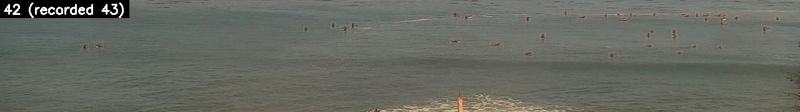](frame_pairs/boxes_crop2026-07-28_14-32-00.jpg) [clean](../../data/j_shore_cam/surf_crops/crop2026-07-28_14-32-00.jpg)  
[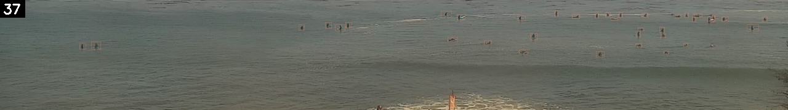](frame_pairs/boxes_crop2026-07-28_14-32-00_side2.jpg) [clean](../../data/j_shore_cam/surf_crops/crop2026-07-28_14-32-00_side2.jpg)  

| Hour | Frames (1.0 s, 2.5 s, 4.0 s) | 3-frame average | Counted (rounded) | Hindcast | Miss (hindcast minus actual) | Date | Time | Day | Weekend | Holiday / long weekend | Month | Surfline rating (0-6) | Tide (ft) | Surf height min (ft) | Surf height max (ft) | Primary swell height (ft) | Primary swell period (s) | Primary swell direction (deg) | Wind speed (mph) | Wind gust (mph) | Wind direction (deg) | Swell energy offshore (kJ) | Swell energy nearshore (kJ) | Wave consistency (waves) | Surfline weather | Weather group | Surfline air temp (F) | Surfline pressure (mb) | Observed air temp (F) | Observed humidity (%) | Observed cloud cover (%) | Observed pressure (mb) | Daylight hours with tide under 3.5 ft | Share of daylight with tide under 3.5 ft | Hours under 3.5 ft left today |
|---|---|---|---|---|---|---|---|---|---|---|---|---|---|---|---|---|---|---|---|---|---|---|---|---|---|---|---|---|---|---|---|---|---|---|---|
| Accurate | crop2026-07-28_15-26-00_side1.jpg crop2026-07-28_15-26-00.jpg crop2026-07-28_15-26-00_side2.jpg | 25.67 | 26 | 23.2 | -2.8 | 2026-07-28 | 15:26 | Tue | 0 | none | 7 | 2 | 3.33 | 1 | 2 | 2.88 | 17 | 208 | 5.4 | 5.4 | 199.7 | 717.5 | 208.8 | 14.95 | CLEAR | CLEAR | 75.3 | 1012 | 74.7 | 58 | 27 | 1012.1 | 6 | 0.6 | 4 |
| Low | crop2026-07-28_14-32-00_side1.jpg crop2026-07-28_14-32-00.jpg crop2026-07-28_14-32-00_side2.jpg | 40 | 40 | 20.5 | -19.5 | 2026-07-28 | 14:32 | Tue | 0 | none | 7 | 2 | 3.64 | 1 | 2 | 2.64 | 17 | 209.9 | 5.48 | 5.48 | 200.7 | 681.5 | 213.2 | 15.47 | CLEAR | CLEAR | 73 | 1014 | 72.3 | 62 | 41 | 1012.9 | 6 | 0.6 | 4 |

## Part 2: different days, matched on forecast, hour, weekday/weekend and conditions

No holidays or long weekends; those appear only in Part 1, compared within the same day.

Matched within 3 on the hindcast, within an hour, on weekday/weekend, then closest on standardized tide (ft), surfline rating (0-6), surf height max (ft), primary swell height (ft), primary swell period (s), wind speed (mph), observed air temp (f), daylight hours with tide under 3.5 ft.

### Pair 1: 2026-08-15 (Sat) against 2026-08-16 (Sun), condition distance 0.64

**Accurate: 2026-08-15 11:59** (actual 33, hindcast 31.1, miss -1.9)

[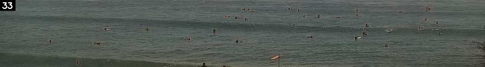](frame_pairs/boxes_crop2026-08-15_11-59-00_side1.jpg) [clean](../../data/j_shore_cam/surf_crops/crop2026-08-15_11-59-00_side1.jpg)  
[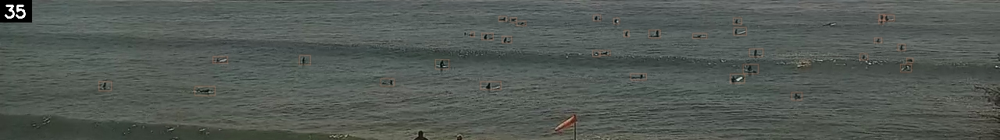](frame_pairs/boxes_crop2026-08-15_11-59-00.jpg) [clean](../../data/j_shore_cam/surf_crops/crop2026-08-15_11-59-00.jpg)  
[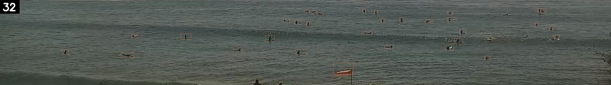](frame_pairs/boxes_crop2026-08-15_11-59-00_side2.jpg) [clean](../../data/j_shore_cam/surf_crops/crop2026-08-15_11-59-00_side2.jpg)  

**Low: 2026-08-16 11:05** (actual 43, hindcast 30.7, miss -12.3)

[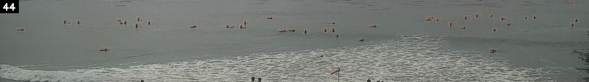](frame_pairs/boxes_crop2026-08-16_11-05-00_side1.jpg) [clean](../../data/j_shore_cam/surf_crops/crop2026-08-16_11-05-00_side1.jpg)  
[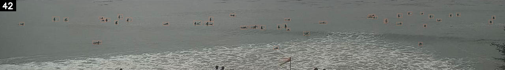](frame_pairs/boxes_crop2026-08-16_11-05-00.jpg) [clean](../../data/j_shore_cam/surf_crops/crop2026-08-16_11-05-00.jpg)  
[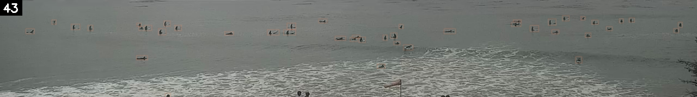](frame_pairs/boxes_crop2026-08-16_11-05-00_side2.jpg) [clean](../../data/j_shore_cam/surf_crops/crop2026-08-16_11-05-00_side2.jpg)  

| Hour | Frames (1.0 s, 2.5 s, 4.0 s) | 3-frame average | Counted (rounded) | Hindcast | Miss (hindcast minus actual) | Date | Time | Day | Weekend | Holiday / long weekend | Month | Surfline rating (0-6) | Tide (ft) | Surf height min (ft) | Surf height max (ft) | Primary swell height (ft) | Primary swell period (s) | Primary swell direction (deg) | Wind speed (mph) | Wind gust (mph) | Wind direction (deg) | Swell energy offshore (kJ) | Swell energy nearshore (kJ) | Wave consistency (waves) | Surfline weather | Weather group | Surfline air temp (F) | Surfline pressure (mb) | Observed air temp (F) | Observed humidity (%) | Observed cloud cover (%) | Observed pressure (mb) | Daylight hours with tide under 3.5 ft | Share of daylight with tide under 3.5 ft | Hours under 3.5 ft left today |
|---|---|---|---|---|---|---|---|---|---|---|---|---|---|---|---|---|---|---|---|---|---|---|---|---|---|---|---|---|---|---|---|---|---|---|---|
| Accurate | crop2026-08-15_11-59-00_side1.jpg crop2026-08-15_11-59-00.jpg crop2026-08-15_11-59-00_side2.jpg | 33.33 | 33 | 31.1 | -1.9 | 2026-08-15 | 11:59 | Sat | 1 | none | 8 | 3 | 3.68 | 2 | 3 | 2.64 | 17 | 208 | 3.25 | 3.36 | 231.7 | 479.3 | 235.3 | 24.17 | MOSTLY_CLOUDY | CLOUDY_OVERCAST | 63.8 | 1021 | 64 | 80 | 43 | 1019.4 | 9 | 0.6 | 4 |
| Low | crop2026-08-16_11-05-00_side1.jpg crop2026-08-16_11-05-00.jpg crop2026-08-16_11-05-00_side2.jpg | 43 | 43 | 30.7 | -12.3 | 2026-08-16 | 11:05 | Sun | 1 | none | 8 | 3 | 3.32 | 2 | 3 | 3.12 | 16 | 199.3 | 2.95 | 2.95 | 225.1 | 406.8 | 202.4 | 27.02 | MOSTLY_CLEAR | CLEAR | 66 | 1020 | 65.8 | 75 | 95 | 1019.2 | 10 | 0.67 | 5 |

### Pair 2: 2026-07-06 (Mon) against 2026-08-31 (Mon), condition distance 0.87

**Accurate: 2026-07-06 09:44** (actual 32, hindcast 30.4, miss -1.6)

[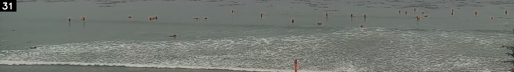](frame_pairs/boxes_crop2026-07-06_09-44-00_side1.jpg) [clean](../../data/j_shore_cam/surf_crops/crop2026-07-06_09-44-00_side1.jpg)  
[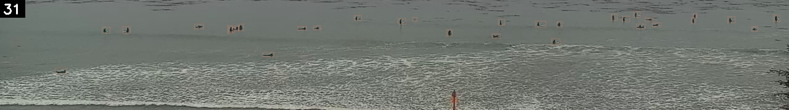](frame_pairs/boxes_crop2026-07-06_09-44-00.jpg) [clean](../../data/j_shore_cam/surf_crops/crop2026-07-06_09-44-00.jpg)  
[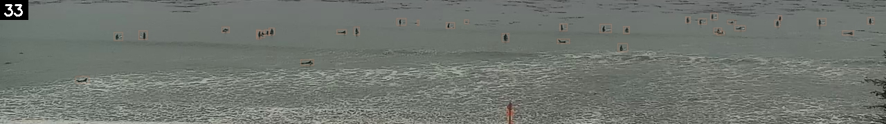](frame_pairs/boxes_crop2026-07-06_09-44-00_side2.jpg) [clean](../../data/j_shore_cam/surf_crops/crop2026-07-06_09-44-00_side2.jpg)  

**Low: 2026-08-31 08:50** (actual 41, hindcast 27.9, miss -13.1)

[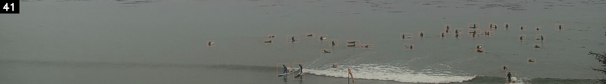](frame_pairs/boxes_crop2026-08-31_08-50-00_side1.jpg) [clean](../../data/j_shore_cam/surf_crops/crop2026-08-31_08-50-00_side1.jpg)  
[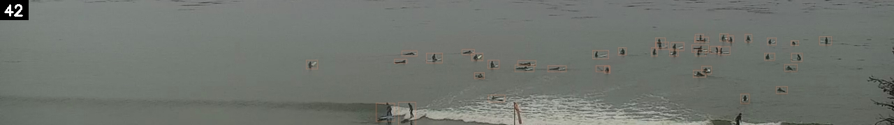](frame_pairs/boxes_crop2026-08-31_08-50-00.jpg) [clean](../../data/j_shore_cam/surf_crops/crop2026-08-31_08-50-00.jpg)  
[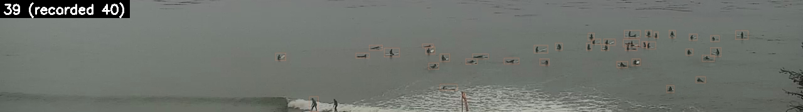](frame_pairs/boxes_crop2026-08-31_08-50-00_side2.jpg) [clean](../../data/j_shore_cam/surf_crops/crop2026-08-31_08-50-00_side2.jpg)  

| Hour | Frames (1.0 s, 2.5 s, 4.0 s) | 3-frame average | Counted (rounded) | Hindcast | Miss (hindcast minus actual) | Date | Time | Day | Weekend | Holiday / long weekend | Month | Surfline rating (0-6) | Tide (ft) | Surf height min (ft) | Surf height max (ft) | Primary swell height (ft) | Primary swell period (s) | Primary swell direction (deg) | Wind speed (mph) | Wind gust (mph) | Wind direction (deg) | Swell energy offshore (kJ) | Swell energy nearshore (kJ) | Wave consistency (waves) | Surfline weather | Weather group | Surfline air temp (F) | Surfline pressure (mb) | Observed air temp (F) | Observed humidity (%) | Observed cloud cover (%) | Observed pressure (mb) | Daylight hours with tide under 3.5 ft | Share of daylight with tide under 3.5 ft | Hours under 3.5 ft left today |
|---|---|---|---|---|---|---|---|---|---|---|---|---|---|---|---|---|---|---|---|---|---|---|---|---|---|---|---|---|---|---|---|---|---|---|---|
| Accurate | crop2026-07-06_09-44-00_side1.jpg crop2026-07-06_09-44-00.jpg crop2026-07-06_09-44-00_side2.jpg | 31.67 | 32 | 30.4 | -1.6 | 2026-07-06 | 09:44 | Mon | 0 | none | 7 | 3 | 0.71 | 1 | 2 | 1.77 | 13 | 196.3 | 3.07 | 3.07 | 233.8 | 504.2 | 183.7 | 36.39 | MOSTLY_CLOUDY | CLOUDY_OVERCAST | 58 | 1016 | 57.2 | 90 | 100 | 1015.2 | 9 | 0.6 | 6 |
| Low | crop2026-08-31_08-50-00_side1.jpg crop2026-08-31_08-50-00.jpg crop2026-08-31_08-50-00_side2.jpg | 41 | 41 | 27.9 | -13.1 | 2026-08-31 | 08:50 | Mon | 0 | none | 8 | 3 | 1.61 | 1 | 2 | 2.67 | 14 | 204.4 | 2.66 | 3.58 | 241.1 | 523.6 | 180.6 | 30.12 | MOSTLY_CLOUDY | CLOUDY_OVERCAST | 57.5 | 1015 | 55.9 | 92 | 100 | 1013.4 | 8 | 0.62 | 7 |

### Pair 3: 2026-07-26 (Sun) against 2026-08-29 (Sat), condition distance 1.75

**Accurate: 2026-07-26 16:11** (actual 31, hindcast 33.7, miss +2.7)

[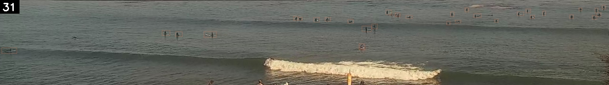](frame_pairs/boxes_crop2026-07-26_16-11-00_side1.jpg) [clean](../../data/j_shore_cam/surf_crops/crop2026-07-26_16-11-00_side1.jpg)  
[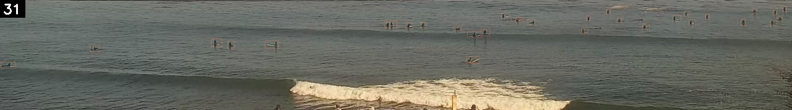](frame_pairs/boxes_crop2026-07-26_16-11-00.jpg) [clean](../../data/j_shore_cam/surf_crops/crop2026-07-26_16-11-00.jpg)  
[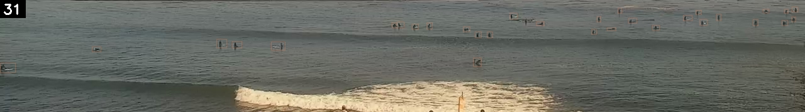](frame_pairs/boxes_crop2026-07-26_16-11-00_side2.jpg) [clean](../../data/j_shore_cam/surf_crops/crop2026-07-26_16-11-00_side2.jpg)  

**Low: 2026-08-29 17:50** (actual 55, hindcast 32.9, miss -22.1)

[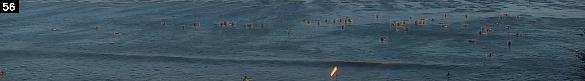](frame_pairs/boxes_crop2026-08-29_17-50-00_side1.jpg) [clean](../../data/j_shore_cam/surf_crops/crop2026-08-29_17-50-00_side1.jpg)  
[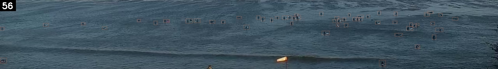](frame_pairs/boxes_crop2026-08-29_17-50-00.jpg) [clean](../../data/j_shore_cam/surf_crops/crop2026-08-29_17-50-00.jpg)  
[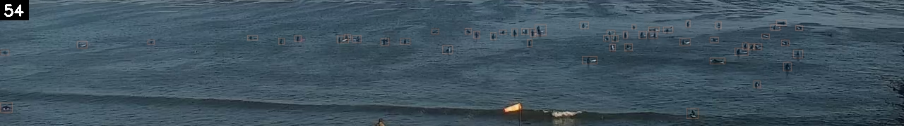](frame_pairs/boxes_crop2026-08-29_17-50-00_side2.jpg) [clean](../../data/j_shore_cam/surf_crops/crop2026-08-29_17-50-00_side2.jpg)  

| Hour | Frames (1.0 s, 2.5 s, 4.0 s) | 3-frame average | Counted (rounded) | Hindcast | Miss (hindcast minus actual) | Date | Time | Day | Weekend | Holiday / long weekend | Month | Surfline rating (0-6) | Tide (ft) | Surf height min (ft) | Surf height max (ft) | Primary swell height (ft) | Primary swell period (s) | Primary swell direction (deg) | Wind speed (mph) | Wind gust (mph) | Wind direction (deg) | Swell energy offshore (kJ) | Swell energy nearshore (kJ) | Wave consistency (waves) | Surfline weather | Weather group | Surfline air temp (F) | Surfline pressure (mb) | Observed air temp (F) | Observed humidity (%) | Observed cloud cover (%) | Observed pressure (mb) | Daylight hours with tide under 3.5 ft | Share of daylight with tide under 3.5 ft | Hours under 3.5 ft left today |
|---|---|---|---|---|---|---|---|---|---|---|---|---|---|---|---|---|---|---|---|---|---|---|---|---|---|---|---|---|---|---|---|---|---|---|---|
| Accurate | crop2026-07-26_16-11-00_side1.jpg crop2026-07-26_16-11-00.jpg crop2026-07-26_16-11-00_side2.jpg | 31 | 31 | 33.7 | +2.7 | 2026-07-26 | 16:11 | Sun | 1 | none | 7 | 3 | 3.41 | 1 | 2 | 2.4 | 19 | 214.7 | 4.29 | 4.29 | 171.6 | 599.5 | 227.4 | 19.02 | CLEAR | CLEAR | 77 | 1015 | 81.3 | 55 | 7 | 1013.8 | 7 | 0.54 | 1 |
| Low | crop2026-08-29_17-50-00_side1.jpg crop2026-08-29_17-50-00.jpg crop2026-08-29_17-50-00_side2.jpg | 55.33 | 55 | 32.9 | -22.1 | 2026-08-29 | 17:50 | Sat | 1 | none | 8 | 3 | 1.79 | 1 | 2 | 2.67 | 17 | 207.1 | 5.93 | 5.93 | 166.7 | 604.7 | 191.8 | 23.21 | CLEAR | CLEAR | 78.5 | 1013 | 75.2 | 57 | 7 | 1012.1 | 9 | 0.64 | 3 |

### Pair 4: 2026-07-18 (Sat) against 2026-08-01 (Sat), condition distance 1.77

**Accurate: 2026-07-18 10:47** (actual 33, hindcast 35.0, miss +2.0)

[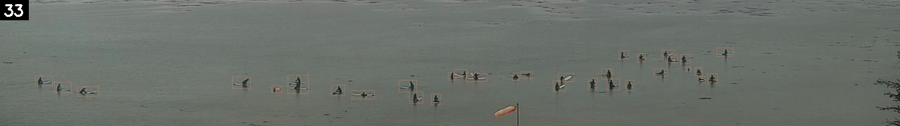](frame_pairs/boxes_crop2026-07-18_10-47-00_side1.jpg) [clean](../../data/j_shore_cam/surf_crops/crop2026-07-18_10-47-00_side1.jpg)  
[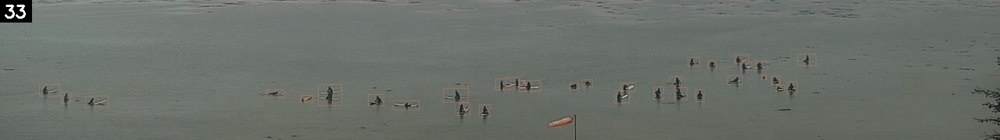](frame_pairs/boxes_crop2026-07-18_10-47-00.jpg) [clean](../../data/j_shore_cam/surf_crops/crop2026-07-18_10-47-00.jpg)  
 [clean](../../data/j_shore_cam/surf_crops/crop2026-07-18_10-47-00_side2.jpg)  

**Low: 2026-08-01 10:02** (actual 48, hindcast 36.3, miss -11.7)

 [clean](../../data/j_shore_cam/surf_crops/crop2026-08-01_10-02-00_side1.jpg)  
 [clean](../../data/j_shore_cam/surf_crops/crop2026-08-01_10-02-00.jpg)  
 [clean](../../data/j_shore_cam/surf_crops/crop2026-08-01_10-02-00_side2.jpg)  

| Hour | Frames (1.0 s, 2.5 s, 4.0 s) | 3-frame average | Counted (rounded) | Hindcast | Miss (hindcast minus actual) | Date | Time | Day | Weekend | Holiday / long weekend | Month | Surfline rating (0-6) | Tide (ft) | Surf height min (ft) | Surf height max (ft) | Primary swell height (ft) | Primary swell period (s) | Primary swell direction (deg) | Wind speed (mph) | Wind gust (mph) | Wind direction (deg) | Swell energy offshore (kJ) | Swell energy nearshore (kJ) | Wave consistency (waves) | Surfline weather | Weather group | Surfline air temp (F) | Surfline pressure (mb) | Observed air temp (F) | Observed humidity (%) | Observed cloud cover (%) | Observed pressure (mb) | Daylight hours with tide under 3.5 ft | Share of daylight with tide under 3.5 ft | Hours under 3.5 ft left today |
|---|---|---|---|---|---|---|---|---|---|---|---|---|---|---|---|---|---|---|---|---|---|---|---|---|---|---|---|---|---|---|---|---|---|---|---|
| Accurate | crop2026-07-18_10-47-00_side1.jpg crop2026-07-18_10-47-00.jpg crop2026-07-18_10-47-00_side2.jpg | 33 | 33 | 35.0 | +2.0 | 2026-07-18 | 10:47 | Sat | 1 | none | 7 | 2 | 0.8 | 0 | 1 | 2.13 | 15 | 283.4 | 4.75 | 4.75 | 180.3 | 425.8 | 91.5 | 25.4 | CLEAR | CLEAR | 60.1 | 1018 | 61.5 | 80 | 52 | 1016.8 | 9 | 0.64 | 5 |
| Low | crop2026-08-01_10-02-00_side1.jpg crop2026-08-01_10-02-00.jpg crop2026-08-01_10-02-00_side2.jpg | 47.67 | 48 | 36.3 | -11.7 | 2026-08-01 | 10:02 | Sat | 1 | none | 8 | 2 | 2.09 | 1 | 2 | 3.08 | 13 | 185.4 | 4.38 | 4.38 | 186.9 | 509.6 | 107.2 | 38.87 | MOSTLY_CLEAR | CLEAR | 59.4 | 1017 | 62.8 | 78 | 73 | 1015.7 | 9 | 0.64 | 5 |

### Pair 5: 2026-09-10 (Thu) against 2026-10-13 (Tue), condition distance 2.36

**Accurate: 2026-09-10 14:23** (actual 34, hindcast 32.4, miss -1.6)

 [clean](../../data/j_shore_cam/surf_crops/crop2026-09-10_14-23-00_side1.jpg)  
 [clean](../../data/j_shore_cam/surf_crops/crop2026-09-10_14-23-00.jpg)  
 [clean](../../data/j_shore_cam/surf_crops/crop2026-09-10_14-23-00_side2.jpg)  

**Low: 2026-10-13 15:44** (actual 46, hindcast 30.6, miss -15.4)

 [clean](../../data/j_shore_cam/surf_crops/crop2026-10-13_15-44-00_side1.jpg)  
 [clean](../../data/j_shore_cam/surf_crops/crop2026-10-13_15-44-00.jpg)  
 [clean](../../data/j_shore_cam/surf_crops/crop2026-10-13_15-44-00_side2.jpg)  

| Hour | Frames (1.0 s, 2.5 s, 4.0 s) | 3-frame average | Counted (rounded) | Hindcast | Miss (hindcast minus actual) | Date | Time | Day | Weekend | Holiday / long weekend | Month | Surfline rating (0-6) | Tide (ft) | Surf height min (ft) | Surf height max (ft) | Primary swell height (ft) | Primary swell period (s) | Primary swell direction (deg) | Wind speed (mph) | Wind gust (mph) | Wind direction (deg) | Swell energy offshore (kJ) | Swell energy nearshore (kJ) | Wave consistency (waves) | Surfline weather | Weather group | Surfline air temp (F) | Surfline pressure (mb) | Observed air temp (F) | Observed humidity (%) | Observed cloud cover (%) | Observed pressure (mb) | Daylight hours with tide under 3.5 ft | Share of daylight with tide under 3.5 ft | Hours under 3.5 ft left today |
|---|---|---|---|---|---|---|---|---|---|---|---|---|---|---|---|---|---|---|---|---|---|---|---|---|---|---|---|---|---|---|---|---|---|---|---|
| Accurate | crop2026-09-10_14-23-00_side1.jpg crop2026-09-10_14-23-00.jpg crop2026-09-10_14-23-00_side2.jpg | 33.67 | 34 | 32.4 | -1.6 | 2026-09-10 | 14:23 | Thu | 0 | none | 9 | 3 | 2.98 | 2 | 3 | 2.15 | 17 | 216.1 | 4.22 | 4.22 | 179.7 | 623.6 | 280.1 | 41.99 | CLEAR | CLEAR | 83 | 1013 | 88.5 | 42 | 13 | 1012.6 | 9 | 0.64 | 6 |
| Low | crop2026-10-13_15-44-00_side1.jpg crop2026-10-13_15-44-00.jpg crop2026-10-13_15-44-00_side2.jpg | 46 | 46 | 30.6 | -15.4 | 2026-10-13 | 15:44 | Tue | 0 | none | 10 | 3 | 3.33 | 3 | 4 | 2.51 | 18 | 199.1 | 4.76 | 4.76 | 243 | 1257.1 | 490.9 | 22.12 | CLEAR | CLEAR | 69 | 1017 | 73.8 | 19 | 0 | 1015.4 | 7 | 0.54 | 4 |
